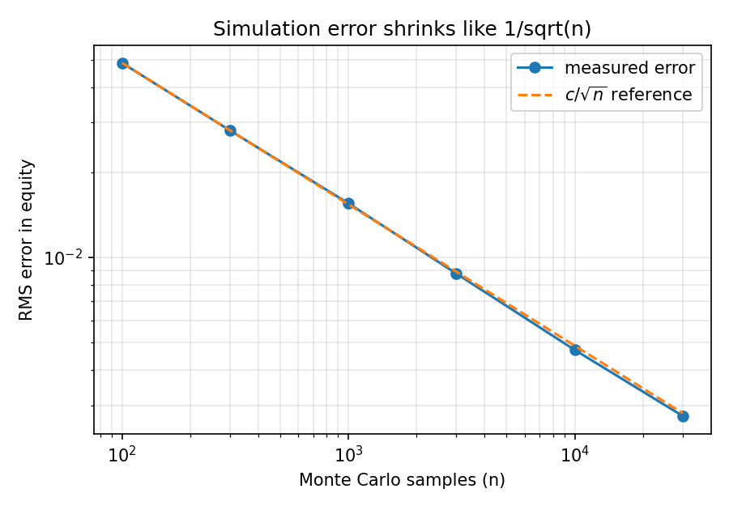

# Poker Odds Calculator

Computes Texas Hold'em win probabilities two ways and compares them:

- **Exact enumeration:** tries every possible way the unknown cards can fall and counts.
- **Monte Carlo simulation:** deals the unknown cards randomly many times and counts.

Pure Python, no dependencies (matplotlib only for the optional experiment).

## Usage

```bash
python -m poker_odds AsAh KsKh                          # vs a known hand, simulated
python -m poker_odds AsAh KsKh --board 2c7d9h --exact   # exact, on the flop
python -m poker_odds AsKs random --board QsJs2d         # vs a random hand
python -m unittest discover -s tests -t . -v            # run the tests
python experiments/error_vs_samples.py                  # makes the error plot
```

Cards are rank + suit: `As` = ace of spades, `Td` = ten of diamonds, `7c` = seven of clubs.

## Example

```
$ python -m poker_odds AsAh KsKh --board 2c7d9h --exact
  Win 91.62%   Tie 0.00%   Lose 8.38%      (990 outcomes, 0.01s)

$ python -m poker_odds AsAh KsKh --board 2c7d9h -n 100000
  Equity 0.9175  (+/- 0.0017 at 95% confidence)   (0.74s)
```

## Exact vs simulation

| Situation | Outcomes to check | Exact time |
|-----------|------------------:|-----------:|
| Known villain, flop | 990 | ~0.01 s |
| Known villain, preflop | 1,712,304 | ~12 s |
| Random villain, flop | 1,070,190 | ~8 s |

Simulation answers in under a second but is slightly off. Measured on one flop spot
(exact equity 0.63535), averaging 200 runs per sample size:

| Samples (n) | Average error | Error x sqrt(n) |
|------------:|--------------:|----------------:|
| 100    | 0.0487 | 0.487 |
| 1,000  | 0.0155 | 0.491 |
| 10,000 | 0.0047 | 0.471 |
| 30,000 | 0.0028 | 0.476 |

The last column stays near 0.48, so error is about 0.48 / sqrt(n): to cut the error in
half you need four times as many samples.



## How it is checked

- The fast 7-card hand evaluator is compared against a separate, slow, simple evaluator
  on 20,000 random hands.
- Hand-countable case: a flush draw on the turn wins on exactly 9 of 44 cards.
- Simulation agrees with exact enumeration within its standard error.
- Pocket aces vs a random hand comes out near the well-known 85%.
- Error shrinks as samples grow.

## Files

- `cards.py`: parsing cards from text like `AsKh`.
- `evaluator.py`: scores any 5 to 7 cards as one integer (higher is better).
- `odds.py`: `exact_odds` and `monte_carlo_odds`.
- `experiments/error_vs_samples.py`: the error-vs-samples experiment.
